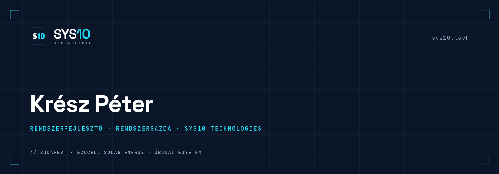
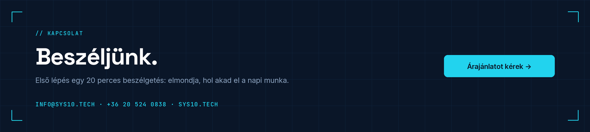

<!-- pterkrsz · Krész Péter · Sys10 Technologies -->

<a href="https://sys10.tech">
  <picture>
    <source media="(prefers-color-scheme: light)" srcset="assets/hero-light.png">
    
  </picture>
</a>

### Rólam · About

Rendszerfejlesztő és rendszergazda Budapesten. A [Sys10 Technologies](https://sys10.tech) nevén dolgozom: egy ember felel az egészért.
A napelemes **Ecocell Solar Energy**-nél IIoT- és energiamonitoring-rendszereken dolgozom, mellette **kiberbiztonság-szakos** hallgató vagyok az Óbudai Egyetemen.

Systems developer and sysadmin in Budapest, working as [Sys10 Technologies](https://sys10.tech). At **Ecocell Solar Energy** I build IIoT and energy-monitoring systems, and I study **cybersecurity** at Óbuda University.

<picture>
  <source media="(prefers-color-scheme: light)" srcset="https://raw.githubusercontent.com/Sys10-Technologies/.github/main/profile/assets/pillars-light.png">
  
</picture>

### Szakterületek · Expertise

| | |
|---|---|
| **CRM / ERP** | Odoo, egyedi modulok, integráció, automatizálás, migráció |
| **Web** | landing page, reszponzív oldalak, tiszta kód |
| **Mobil app** | cross-platform iOS/Android |
| **IIoT és adat** | ipari adatgyűjtés (Modbus/MQTT), time-series, dashboardok |
| **Rendszergazda** | hálózat (VLAN/OSPF/VPN), szerver, TrueNAS/Proxmox |
| **IT-biztonság** | infrastruktúra- és app-penteszt, audit, GDPR |

  
  
  
  
  
  
  
  
  
  
  
  
  

### Kiemelt projektek · Featured

| Év | Projekt | |
|---|---|---|
| 2026 | **Solar Inverter Monitor** | WPF desktop app inverterek valós idejű monitorozására |
| 2025 | **Odoo 17 SaaS → on-premise** | felhő-ERP átköltöztetés saját szerverre |
| 2025 | **Field Service modul** | mobilbarát villanyszerelő-feladatkezelő, vonalkódos követéssel |
| 2025 | **Multi-site mesh VPN** | Tailscale-alapú telephely-összekötés |
| 2024–25 | **Céges IT-infrastruktúra** | komplett hálózat és szerver több telephelyes cégnek |

  

<a href="https://sys10.tech">
  <picture>
    <source media="(prefers-color-scheme: light)" srcset="assets/cta-light.png">
    
  </picture>
</a>

[sys10.tech](https://sys10.tech) · [info@sys10.tech](mailto:info@sys10.tech) · [linkedin.com/in/pterkrsz](https://www.linkedin.com/in/pterkrsz) · [pterkrsz.github.io](https://pterkrsz.github.io)
