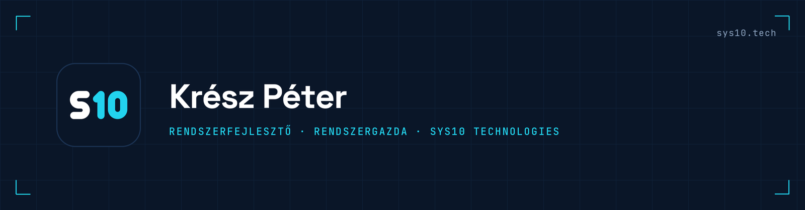

<!-- pterkrsz · Krész Péter · Sys10 Technologies -->

  

  
  
  
  

### Rólam · About

Rendszerfejlesztő és rendszergazda Budapesten. A [Sys10 Technologies](https://sys10.tech) nevén dolgozom: egy ember felel az egészért.
A napelemes **Ecocell Solar Energy**-nél IIoT- és energiamonitoring-rendszereken dolgozom, mellette **kiberbiztonság-szakos** hallgató vagyok az Óbudai Egyetemen.

Systems developer and sysadmin in Budapest, behind [Sys10 Technologies](https://sys10.tech).
At **Ecocell Solar Energy** I build IIoT and energy-monitoring systems, and I study **cybersecurity** at Óbuda University.

### Sys10 Technologies

| | Pillér | Amit vállalok |
|---|---|---|
| `01` | **Helios** | Saját alkalmazásplatform, cégre szabott webes appokkal: ügyfélkezelés, munkalap, készlet, bérlés, jóváhagyás. |
| `02` | **Webfejlesztés** | Gyors, saját kódbázisú weboldalak és webalkalmazások. Nem sablonból. |
| `03` | **IT-üzemeltetés** | Microsoft 365 vagy Google Workspace, hálózat, levelezés, mentés. Havidíjért, negyedévente kipróbált visszaállítással. |

### Szakterületek · Expertise

| | |
|---|---|
| **CRM / ERP** | Odoo, egyedi modulok, integráció, automatizálás, migráció |
| **Web** | landing page, reszponzív oldalak, tiszta kód |
| **Mobil app** | cross-platform iOS/Android |
| **IIoT és adat** | ipari adatgyűjtés (Modbus/MQTT), time-series, dashboardok |
| **Rendszergazda** | hálózat (VLAN/OSPF/VPN), szerver, TrueNAS/Proxmox |
| **IT-biztonság** | infrastruktúra- és app-penteszt, audit, GDPR |

### Tech stack

  
  
  
  
  
  
  
  
  
  
  
  
  

`IIoT` · `Modbus/MQTT` · `time-series` · `ERP migration` · `VLAN/OSPF/VPN` · `network security` · `GDPR`

### Kiemelt projektek · Featured

- **Solar Inverter Monitor** (2026): WPF desktop app inverterek valós idejű monitorozására
- **Odoo 17 SaaS → on-premise migráció** (2025): felhő-ERP átköltöztetés saját szerverre
- **Field Service modul** (2025): mobilbarát villanyszerelő-feladatkezelő, vonalkódos követéssel
- **Céges IT-infrastruktúra** (2024–25): komplett hálózat és szerver több telephelyes cégnek
- **Multi-site mesh VPN** (2025): Tailscale-alapú telephely-összekötés

### GitHub

  

  
  

### Beszéljünk. · Contact

[sys10.tech](https://sys10.tech) · [info@sys10.tech](mailto:info@sys10.tech) · +36 20 524 0838 · [linkedin.com/in/pterkrsz](https://www.linkedin.com/in/pterkrsz) · [pterkrsz.github.io](https://pterkrsz.github.io)
